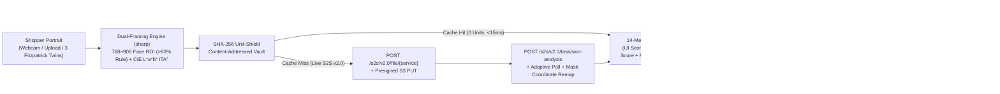

# DermAtelier — Where Clinical Skin AI Governs Virtual Try-On & Checkout

> **Built for the Perfect Corp. YouCam API Skin AI & eCommerce VTO Hackathon**  
> **Tracks:** Main Track (**Skin AI + eCommerce VTO Dual Integration**) & **Rising Star Award** (Student Developer)

**DermAtelier** solves beauty and fashion eCommerce's **$816B reverse-logistics crisis** by closing the gap between **clinical skin biology** and **Virtual Try-On (VTO)**. Standard VTO renders cosmetics and apparel onto a static JPEG as if human skin were flat paper—ignoring whether a matte liquid pigment will micro-flake at `T+4h` on dehydrated skin, whether a titanium-heavy foundation will cast grey-ashy on Fitzpatrick VI skin, whether an acidic chartreuse top will amplify malar redness, or whether a shopper's cart combines barrier-stripping actives (`1.0% Retinol` × `pH 3.4 Glycolic Acid`).

DermAtelier chains **three live-verified Perfect Corp. YouCam S2S v2.0 APIs** into one closed-loop luxury clinical storefront and B2B2C return-prevention platform:

1. **YouCam AI Skin Analysis (`/s2s/v2.0/task/skin-analysis`)** — Evaluates **14 standard `dst_actions`** (`wrinkle`, `pore`, `texture`, `acne`, `redness`, `oiliness`, `moisture`, `age_spot`, `radiance`, `dark_circle_v2`, `firmness`, `eye_bag`, `droopy_upper_eyelid`, `tear_trough`) paired with dermatological **CIE $L^*a^*b^*$ & $\text{ITA}^\circ$ (Individual Typology Angle)** colorimetry, surfacing **both** consumer-calibrated `ui_score` and unmodified clinical `raw_score` alongside remapped spatial alpha masks.
2. **Dermal-Governed Makeup & Apparel VTO (`/s2s/v2.0/task/makeup-vto` & `/s2s/v2.0/task/cloth`)** — Computes a real-time **Dermal Compatibility Matrix** from the shopper's Skin AI telemetry, intercepts high-return clashes before checkout, auto-selects a **Dermal-Calibrated Counterpart**, and renders an interactive **WAI-ARIA Split-Slider Comparison** (Naive Clash SKU vs. Dermal-Matched SKU) with a **`T+0h Fresh` vs. `T+4h Barrier Wear Forecast`** toggle.
3. **Biochemical Cart Solver & Merchant Return-Shield Console** — Audits the shopping bag for pH/retinoid collisions and VTO undertone mismatches, exports a bound **Dermal Telemetry Passport (`.json`)**, and provides eCommerce VPs with a **Live Interactive Shopify PDP Buy-Box Simulator**, a dynamic **SKU × Fitzpatrick II–VI Telemetry Matrix**, and configurable unit-economics sliders.

---

## Architecture, Dual-Framing ROI & 1,000-Unit Shield



### Key Engineering Breakthroughs
- **Dual-Framing Face-ROI Cropping & Coordinate Remapping (`src/lib/youcam/image-framing.ts`)**: YouCam `/s2s/v2.0/task/skin-analysis` enforces a strict `>60%` face-to-image width requirement (`error_src_face_too_small`), whereas `/s2s/v2.0/task/cloth` requires full upper-torso framing (`896×1200`). Our `sharp` pipeline extracts a centered `768×906` macro face ROI (`~70%` face width) for `skin-analysis` and `makeup-vto`, then projects returned PNG alpha masks (`remapCroppedMaskToFullPortrait`) and rendered VTO patches (`compositeCroppedRenderOntoPortrait` with feathered edges) seamlessly back onto full-portrait coordinates.
- **CIE $L^*a^*b^*$ & $\text{ITA}^\circ$ Dermatological Colorimetry (`src/lib/youcam/image-framing.ts`, `src/lib/youcam/local-cv.ts`)**: Decodes raw sRGB pixels in the bilateral malar skin zone into CIE $XYZ \rightarrow L^*a^*b^*$ and computes $\text{ITA}^\circ = \arctan\left(\frac{L^* - 50}{b^*}\right) \times \frac{180}{\pi}$ for objective Fitzpatrick I–VI classification and shade calibration (`resolveShadeForFitzpatrick`).
- **Live-Verified YouCam S2S v2.0 Lifecycle (`src/lib/youcam/client.ts`)**: End-to-end verified against `https://yce-api-01.makeupar.com` across `/s2s/v2.0/file/{service}`, presigned S3 `PUT` (with case-insensitive `Content-Type` header deduplication to protect AWS SigV4 signatures), `/s2s/v2.0/task/skin-analysis`, `/s2s/v2.0/task/makeup-vto` (`foundation`, `lip_color`, `blush`), and `/s2s/v2.0/task/cloth`.
- **SHA-256 Unit-Shield & Immutable S3 Asset Persistence (`src/lib/youcam/cache.ts`)**: Hashes `(service, imageSha256, canonicalParams)` and persists temporary 2-hour (`X-Amz-Expires=7200`) S3 mask and VTO output URLs into `.youcam-cache/` so cached demos never expire and consume **0 extra API units**.

---

## Quick Start

### 1. Install Dependencies
```bash
npm install
```

### 2. Configure YouCam API Key (Optional for Instant Demo, Used for Live S2S Calls)
```bash
cp .env.example .env
```
Add your Perfect Corp. YouCam Bearer key (`https://yce.makeupar.com/api-console/en/api-keys/`) to `.env`:
```env
YOUCAM_API_KEY=your_bearer_api_key_here
YOUCAM_TOTAL_REDEEMED_UNITS=1000
YOUCAM_MAX_BUDGET_UNITS=150
```
*(You can also paste your key directly inside the **1,000-Unit Shield** drawer in the top-right corner of the web UI without restarting the server.)*

### 3. Run Development Server
```bash
npm run dev
```
Open **http://localhost:3000**.

### 4. Run Typecheck, Automated Tests & Production Build
```bash
npm run typecheck
npm test
npm run build
```

### 5. Optional: Run Live S2S v2.0 CLI Verifiers
```bash
npm run verify:youcam   # Live /s2s/v2.0/task/skin-analysis smoke test (1 unit)
npm run verify:vto      # Live /s2s/v2.0/task/makeup-vto + /s2s/v2.0/task/cloth smoke test
```

---

## Production Deployment

### Option A: Vercel (60-Second Zero-Config Deploy)
1. Push this repository to GitHub and import it at **https://vercel.com/new**.
2. Add the following Environment Variables in **Project Settings → Environment Variables**:
   - `YOUCAM_API_KEY` — Your Perfect Corp. YouCam S2S v2.0 Bearer key
   - `YOUCAM_TOTAL_REDEEMED_UNITS` — `1000`
   - `YOUCAM_MAX_BUDGET_UNITS` — `150` *(caps live spend per deployment instance)*
3. Click **Deploy**. `next.config.ts` externalizes `sharp` (`serverExternalPackages: ["fflate", "sharp"]`), and `src/lib/youcam/cache.ts` automatically routes the SHA-256 Unit-Shield cache to `/tmp/youcam-cache` when `process.env.VERCEL` is present.

### Option B: Docker / Railway / Fly.io / Google Cloud Run (Persistent Cache Volume)
```bash
docker build -t dermatelier .
docker run -p 3000:3000 \
  -e YOUCAM_API_KEY="your_bearer_api_key_here" \
  -e YOUCAM_TOTAL_REDEEMED_UNITS=1000 \
  -e YOUCAM_MAX_BUDGET_UNITS=250 \
  -v dermatelier_cache:/app/.youcam-cache \
  dermatelier
```

---

## Repository Structure

```text
YouCam/
├── public/demo/                  # Unretouched Fitzpatrick II/IV/VI portraits & ghost-mannequin garments
├── scripts/
│   ├── verify-youcam.mjs         # Live CLI verifier for YouCam S2S v2.0 skin-analysis
│   └── verify-all-vto.mjs        # Live CLI verifier for YouCam S2S v2.0 makeup-vto & cloth
├── src/
│   ├── app/
│   │   ├── api/youcam/
│   │   │   ├── ledger/route.ts         # Live 1,000-Unit Shield telemetry & cache hit ledger
│   │   │   ├── skin-analysis/route.ts  # S2S v2.0 Skin Analysis endpoint
│   │   │   └── vto/route.ts            # S2S v2.0 Makeup VTO & AI Clothes VTO endpoint
│   │   ├── globals.css
│   │   ├── layout.tsx
│   │   └── page.tsx
│   ├── components/
│   │   ├── DermAtelierApp.tsx          # Pipeline bar, audio briefing, 3-stage workbench & passport export
│   │   ├── PortraitVtoCanvas.tsx       # Spatial masks, WAI-ARIA Split-Slider VTO & T+4h Wear Forecast
│   │   ├── MerchantRoiView.tsx         # Live SKU × Fitzpatrick II–VI matrix & Shopify PDP simulator
│   │   ├── UnitShieldDrawer.tsx        # S2S HTTP step trace inspector & session key vault
│   │   └── WebcamCaptureModal.tsx      # Dual-zone 68% Face Macro + Shoulder alignment capture
│   └── lib/youcam/
│       ├── types.ts                    # Complete TypeScript contracts
│       ├── image-framing.ts            # sharp Dual-Framing ROI, mask remapping & CIE L*a*b* ITA°
│       ├── cache.ts                    # SHA-256 content-addressed cache & S3 asset persistence
│       ├── client.ts                   # Perfect Corp YouCam S2S v2.0 client (File + Task + Poll)
│       ├── dermal-engine.ts            # Finish × Biology physics & Biochemical Cart Solver
│       ├── catalog.ts                  # 12-SKU lip, complexion, apparel & clinical active catalog
│       ├── presets.ts                  # Fitzpatrick II, IV, VI studio personas & landmarks
│       └── local-cv.ts                 # Decoded sRGB pixel CIE L*a*b* / ITA° deterministic fallback
└── tests/
    ├── dermal-engine.test.ts           # Physics, CIE L*a*b* ITA°, catalog integrity & cart solver tests
    ├── youcam-client.test.ts           # S2S v2.0 makeup-vto/cloth/skin-analysis & SHA-256 cache tests
    └── api-routes.test.ts              # Next.js App Router /api/youcam/* route handler integration tests
```
