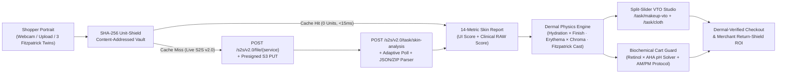

# DermAtelier — Where Clinical Skin AI Governs Virtual Try-On & Checkout

> **Built for the Perfect Corp. YouCam API Skin AI & eCommerce VTO Hackathon**  
> **Tracks:** Main Track (**Skin AI + eCommerce VTO Dual Integration**) & **Rising Star Award** (Student Developer)

**DermAtelier** solves beauty and fashion eCommerce's **$816B reverse-logistics crisis** by closing the gap between **clinical skin biology** and **Virtual Try-On (VTO)**. Standard VTO renders cosmetics and apparel onto a static JPEG as if human skin were flat paper—ignoring whether a matte liquid pigment will cling to dehydrated micro-texture, whether a titanium-heavy foundation will cast grey-ashy on Fitzpatrick VI skin, whether an acidic chartreuse top will amplify malar redness, or whether a shopper's cart combines barrier-stripping actives (`1.0% Retinol` × `pH 3.4 Glycolic Acid`).

DermAtelier chains **three Perfect Corp. YouCam S2S v2.0 APIs** into one closed-loop storefront and B2B2C return-prevention engine:

1. **YouCam AI Skin Analysis (`/s2s/v2.0/task/skin-analysis`)** — Evaluates **14 standard `dst_actions`** (`wrinkle`, `pore`, `texture`, `acne`, `redness`, `oiliness`, `moisture`, `age_spot`, `radiance`, `dark_circle_v2`, `firmness`, `eye_bag`, `droopy_upper_eyelid`, `tear_trough`), surfacing **both** consumer-calibrated `ui_score` and unmodified clinical `raw_score` alongside spatial zone heatmaps and PNG masks.
2. **Dermal-Governed Makeup & Apparel VTO (`/s2s/v2.0/task/makeup-vto` & `/s2s/v2.0/task/cloth`)** — Computes a real-time **Dermal Compatibility Matrix** from the shopper's Skin AI telemetry, intercepts high-return clashes before checkout, auto-selects a **Dermal-Calibrated Counterpart**, and renders an interactive **Split-Slider Comparison** (Naive Clash SKU vs. Dermal-Matched SKU) on the shopper's portrait.
3. **Biochemical Cart Solver & Merchant Return-Shield Console** — Audits the shopping bag for pH/retinoid collisions and VTO undertone mismatches, sequences items into **Wear Now · AM Protect · PM Renew** protocols, and provides eCommerce VPs with live **Return-Rate Drop (44.2% → 11.4%)** telemetry and a 1-line headless/Shopify PDP drop-in snippet.

---

## Architecture & 1,000-Unit Shield



### Key Technical Highlights
- **Authentic YouCam S2S v2.0 Lifecycle (`src/lib/youcam/client.ts`)**: Implements service-scoped File API initialization (`/s2s/v2.0/file/{service}` with automatic `/s2s/v2.0/file` fallback), binary `PUT` to presigned S3 storage, asynchronous task creation, adaptive status polling, and dual parsing for **both** JSON `results.output` and `.zip` (`score_info.json` + alpha mask PNGs via `fflate`).
- **SHA-256 Unit-Shield & Immutable Asset Persistence (`src/lib/youcam/cache.ts`)**: Protects API unit allocations by hashing `(service, imageSha256, canonicalParams)`. Temporary presigned S3 mask and VTO result URLs are persisted locally into `.youcam-cache/assets/` so cached demos never suffer from expired S3 links, and repeated scans/reloads consume **0 API units**.
- **Inclusive Fitzpatrick II–VI Calibration (`src/lib/youcam/presets.ts`)**: Ships with three unretouched clinical studio portraits (**Ananya · Fitzpatrick IV Warm-Olive**, **Claire · Fitzpatrick II Cool-Porcelain**, **Zuri · Fitzpatrick VI Deep Warm-Golden**) plus live `getUserMedia` webcam capture and custom photo upload.

---

## Quick Start

### 1. Install Dependencies
```bash
npm install
```

### 2. Configure YouCam API Key (Optional for Instant Demo, Required for Live S2S Calls)
```bash
cp .env.example .env
```
Add your Perfect Corp. YouCam Bearer key (`https://yce.makeupar.com/api-console/en/api-keys/`) to `.env`:
```env
YOUCAM_API_KEY=your_bearer_api_key_here
YOUCAM_TOTAL_REDEEMED_UNITS=1000
YOUCAM_MAX_BUDGET_UNITS=150
```
*(You can also paste your key directly inside the **1,000-Unit Shield** drawer in the top-right corner of the web UI without restarting the server!)*

### 3. Run Development Server
```bash
npm run dev
```
Open **http://localhost:3000**.

### 4. Run Tests, Typecheck & Production Build
```bash
npm run typecheck
npm test
npm run build
```

### 5. Optional: Run 1-Unit Live CLI Smoke Verification
```bash
npm run verify:youcam
```

---

## Repository Structure

```text
YouCam/
├── public/demo/                  # Unretouched Fitzpatrick II/IV/VI portraits & ghost-mannequin garments
├── scripts/verify-youcam.mjs     # Standalone CLI verifier for live YouCam S2S v2.0 skin-analysis
├── src/
│   ├── app/
│   │   ├── api/youcam/
│   │   │   ├── ledger/route.ts         # Live 1,000-Unit Shield telemetry & cache hit ledger
│   │   │   ├── skin-analysis/route.ts  # S2S v2.0 Skin Analysis endpoint
│   │   │   └── vto/route.ts            # S2S v2.0 Makeup VTO & AI Clothes VTO endpoint
│   │   ├── globals.css
│   │   ├── layout.tsx
│   │   └── page.tsx
│   ├── components/
│   │   ├── DermAtelierApp.tsx          # 3-stage shopper workbench & bag orchestrator
│   │   ├── PortraitVtoCanvas.tsx       # Spatial zone heatmaps + draggable Split-Slider VTO
│   │   ├── MerchantRoiView.tsx         # B2B Return-Shield KPIs, SKU clash matrix & PDP embed
│   │   ├── UnitShieldDrawer.tsx        # S2S HTTP step trace inspector & session key vault
│   │   └── WebcamCaptureModal.tsx      # Mirrored webcam oval alignment & auto-resizer
│   └── lib/youcam/
│       ├── types.ts                    # Complete TypeScript contracts
│       ├── cache.ts                    # SHA-256 content-addressed cache & S3 asset persistence
│       ├── client.ts                   # Perfect Corp YouCam S2S v2.0 client (File + Task + Poll)
│       ├── dermal-engine.ts            # Finish × Biology physics & Biochemical Cart Solver
│       ├── catalog.ts                  # 12-SKU lip, complexion, apparel & clinical active catalog
│       ├── presets.ts                  # Fitzpatrick II, IV, VI studio personas & landmarks
│       └── local-cv.ts                 # Deterministic byte-signal offline fallback
└── tests/
    ├── dermal-engine.test.ts           # Unit tests for compatibility physics & cart solver
    └── youcam-client.test.ts           # Mocked end-to-end S2S v2.0 HTTP & SHA-256 cache tests
```
